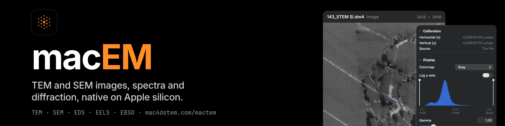

# macEM

TEM and SEM images, EDS and EELS spectrum images, electron diffraction and EBSD, analysed natively on the Mac.

macEM is the companion to [mac4DSTEM](https://github.com/mac4DSTEM/mac4DSTEM). Both are free, open source and built for
Apple silicon.

## Download

Get the signed and notarised DMG from the [latest release](https://github.com/mac4DSTEM/macTEM/releases/latest). It needs
macOS 26 or later on an Apple silicon Mac. The SEM rooms and SEM files below are not in a release yet: to use them
now, build the app yourself.

Up to 1.3 the app was called macTEM. To update, quit macTEM, drag macEM to Applications, then move macTEM to the Trash.
Your recent files, the folders you allowed and your `.mactem.h5` session files carry over.

## What it does

Open a file and work through the sidebar. It lists five workspaces, Imaging, Spectroscopy, Diffraction, EBSD and Results,
and under the one in front its rooms. What the file holds decides the room it opens in. macEM reads:

- **TEM**: DigitalMicrograph (.dm3, .dm4), Velox (.emd), TIFF and MRC images; EDS spectrum images from Velox and GMS,
  EELS spectrum images from GMS, and single .msa spectra.
- **SEM images**: TIFF from Thermo Fisher (FEI), Zeiss and Tescan, read with the microscope's settings, and JEOL .img
  and .map files.
- **SEM-EDS**: Bruker .bcf and .spx, EDAX .spd, .lsd and .spc, JEOL .pts, .eds and .asw, and a single spectrum in a
  HyperSpy .hspy file.
- **EBSD and TKD patterns**: h5ebsd from kikuchipy, Bruker, EDAX and Oxford Instruments (.h5oina), EDAX .up1 and .up2,
  Oxford .ebsp and NORDIF Pattern.dat.
- **Orientation maps**: .ang and .ctf.

TKD patterns are read and indexed as EBSD patterns are; no TKD dataset has been checked in the app yet.

Some files are read together with a file of the same name beside them, so keep them in one folder: an EDAX .spd or
.lsd with its .spc, an EDAX .up1 or .up2 with its .ang, and an Oxford .ebsp with its .ctf. A NORDIF Pattern.dat is read
with the Setting.txt in its folder: the first time, the app asks for that folder. A JEOL .asw project needs the files it
names; the sandboxed app is not given those yet, so it may not open.

No file at hand? Help > Open Demo Data opens generated TEM documents and three public SEM datasets.

The rooms:

- **Image**: calibration, colormap, contrast and gamma; distances, angles, line profiles and particles; image stacks.
  Your marks are saved in a session file next to the image. An SEM TIFF shows the microscope's settings, and a Thermo
  Fisher or Tescan databar can be hidden or shown under the picture.
- **FFT**: the transform of the image or a region, spots and their d-spacings, the radial profile, a masked inverse,
  and ABSF and Wiener filters.
- **EDS**: Velox and GMS spectrum images, and SEM-EDS maps, line scans and spectra. Pick elements from the periodic
  table or let Auto ID suggest them, then get net, wt%, at% and thickness maps, regions, and the Cliff-Lorimer
  composition.
- **EELS**: Dual-EELS spectrum images. Align the zero-loss peak, map t/λ, pick edges from the periodic table, and fit
  their intensities and at%.
- **Diffraction**: calibrate on a ring of a standard, then index rings and spots and read their d-spacings.
- **Patterns**: the EBSD or TKD scan beside the live pattern, with mean intensity, virtual BSE, image quality and
  average dot product maps. Remove the static and dynamic backgrounds, rescale or normalise, equalise, filter, bin,
  average neighbouring patterns and denoise with NLPAR. Draw the Kikuchi bands of the file's stored orientations over
  the pattern. The file stays unchanged.
- **Indexing**: Hough indexing, or dictionary indexing against an EMsoft master pattern, for one or several phases from
  the file, a preset or a CIF. Read each point's solution, compare two results side by side, and export the map as .ang
  or .ctf.
- **Maps**: IPF and phase maps with their colour keys; grains, and grain and phase boundaries over the map; grain size
  (mean and area-weighted ECD, mean lineal intercept, ASTM E112); KAM, GOS and GND; Schmid factors and slip traces; pole
  figures, ODF sections and histograms. A map comes from an .ang, .ctf or map-only .h5oina file, from a pattern file that
  carries one, or from the Indexing room.
- **Results**: every measurement of a file in one table, exported as CSV. The SEM results have a table of their own and
  a session report, as PDF or Markdown.

## Where the numbers come from

The TEM methods compute with the suite's Swift kits, each checked against the Python package it ports, within that
package's own tolerance: [FormatoKit](https://github.com/mac4DSTEM/FormatoKit) (file readers),
[ImagoKit](https://github.com/mac4DSTEM/ImagoKit) (FFT and image maths),
[DiffractoKit](https://github.com/mac4DSTEM/DiffractoKit) (crystallography) and
[SpectroKit](https://github.com/mac4DSTEM/SpectroKit) (EDS and EELS). The SEM methods are ported into the app itself and
checked the same way, against pinned versions of [kikuchipy](https://github.com/pyxem/kikuchipy) (pattern files,
processing and dictionary indexing), [PyEBSDIndex](https://github.com/USNavalResearchLaboratory/PyEBSDIndex) (Hough
indexing and NLPAR), [orix](https://github.com/pyxem/orix) (orientations, colour keys, texture, and .ang and .ctf
files), [DefDAP](https://github.com/MechMicroMan/DefDAP) (grains, GOS and slip; KAM and GND with the departures listed
in `docs/parity.md`), [eXSpy](https://github.com/hyperspy/exspy) (SEM-EDS lines),
[RosettaSciIO](https://github.com/hyperspy/rosettasciio) (the Bruker, EDAX and JEOL SEM-EDS files, and the Thermo Fisher
and Zeiss TIFF settings) and [NexusLIMS](https://github.com/datasophos/NexusLIMS) (the Tescan TIFF settings). The
Kikuchi bands are checked against kikuchipy and [diffsims](https://github.com/pyxem/diffsims). Which SEM function is
checked against what, and to which tolerance, is in [`docs/parity.md`](docs/parity.md). Every result names the method
that made it.

## Building it yourself

You need Xcode 27 or Xcode 26.6 on an Apple silicon Mac with macOS 26 or later. Open `macTEM.xcodeproj`, pick the `macTEM` scheme and press ⌘R. The first build fetches the kits at
the versions in `Package.resolved`. The tests run with `tools/run-tests.sh unit`. How the code is organised is in
[`docs/architecture.md`](docs/architecture.md).

## Problems and ideas

Please open an issue. Bug reports with the file type and what you expected help most. How to contribute is in
[`CONTRIBUTING.md`](CONTRIBUTING.md); security reports go through [`SECURITY.md`](SECURITY.md).

## Citing

If you use macEM in published work, please cite it and the Python packages whose methods it follows. All are in
[`CITATION.cff`](CITATION.cff).

## Licence

GPL-3.0-only ([`LICENSE`](LICENSE)). Third-party notices are in [`NOTICE`](NOTICE).
